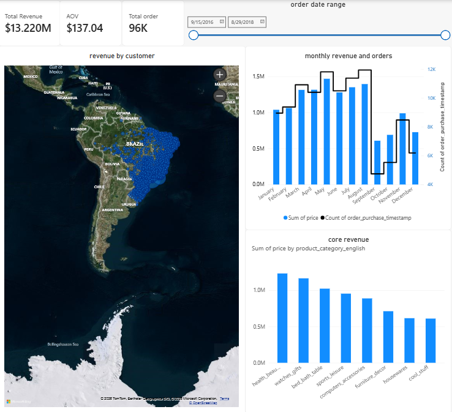
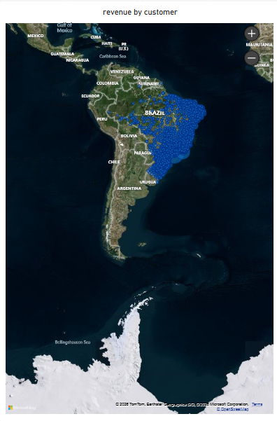
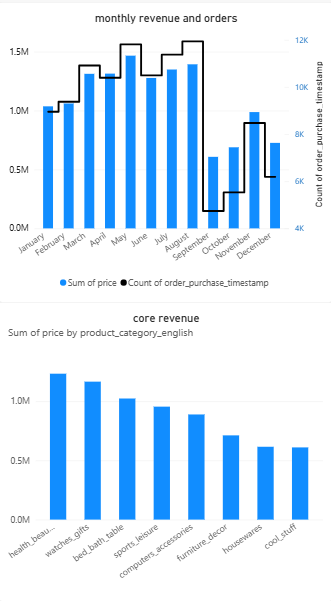
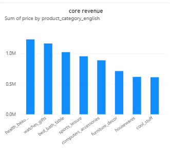
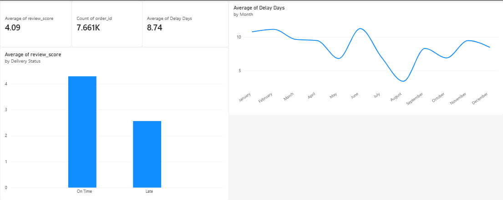
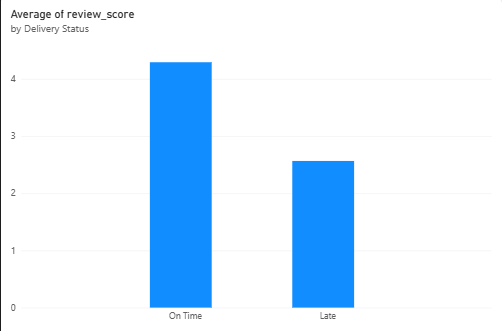
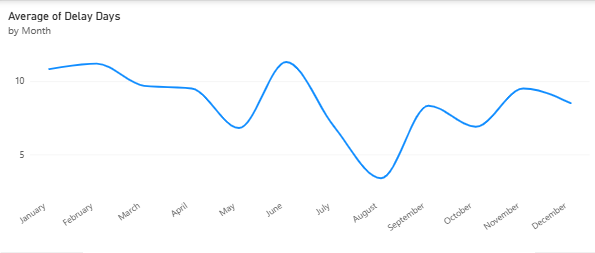
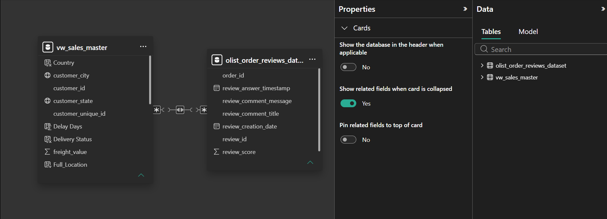

<div align="center">

# 📊 E-Commerce Sales & Customer Analytics

### A Data-Driven Business Case on the Olist Brazilian E-Commerce Dataset


[🇺🇸 English Version](#-english-version) • [🇮🇷 نسخه فارسی](#-نسخه-فارسی)

<!-- 📸 IMAGE #1 (HERO): Full screenshot of the "Overview" page (page 1) of your Power BI report.
     Save as: images/hero.png  (export the page at 1920x1080 for best quality) -->


</div>

---

## 🇺🇸 English Version

### 📑 Table of Contents
- [Executive Summary](#-executive-summary)
- [Business Objectives](#-business-objectives)
- [Tech Stack](#️-tech-stack)
- [Key Insights](#-key-business-insights)
- [Dashboard Preview](#-dashboard-preview)
- [Data Model & DAX](#️-data-model--dax)
- [Project Structure](#-project-structure)
- [How to Reproduce](#️-how-to-reproduce)
- [License & Attribution](#-license--attribution)

### 📖 Executive Summary
An end-to-end data analytics project covering e-commerce **sales, logistics, and customer behavior**. Using the [Brazilian E-Commerce Public Dataset by Olist](https://www.kaggle.com/datasets/olistbr/brazilian-ecommerce), the project analyzes **96,470 delivered orders** (Sep 2016 – Aug 2018) generating **13.2M BRL** in revenue. It combines **T-SQL data cleaning**, **exploratory data analysis (EDA)**, and a **2-page interactive Power BI dashboard** to uncover actionable marketing and operational insights.

| Total Revenue | Total Orders | Avg. Order Value | Product Categories | Period |
|:---:|:---:|:---:|:---:|:---:|
| **13.22M BRL** | **96,470** | **137.04 BRL** | **71** | **Sep 2016 – Aug 2018** |

### 🎯 Business Objectives
As a Performance Marketer and Data Analyst, my goal was not just to write code, but to solve real business problems:

| # | Objective | Question Answered |
|---|-----------|-------------------|
| 1 | **Optimize Marketing Budget** | Which products are the "Cash Cows", and when do customers shop the most? |
| 2 | **Improve Customer Retention** | How much do delivery delays hurt customer satisfaction? |
| 3 | **Streamline Checkout** | Which local payment methods matter, and how can cart abandonment be reduced? |

### 🛠️ Tech Stack

| Layer | Tools |
|-------|-------|
| **Database & Cleaning** | Microsoft SQL Server (SSMS), T-SQL |
| **Visualization & BI** | Power BI (DAX measures, data modeling) |
| **Version Control & Docs** | Git, GitHub, Visual Studio Code |

### 💡 Key Business Insights
Using advanced SQL (multi-table `JOIN`s and subqueries) and Power BI, I extracted the following insights:

| Area | Finding | Recommended Action |
|------|---------|--------------------|
| 🐄 **Cash Cows** | **Health & Beauty** is the top revenue driver (**1.23M BRL**), followed by **Watches & Gifts** (1.17M) and **Bed, Bath & Table** (1.02M). Just **17 of 71 categories** generate 80% of revenue (Pareto effect). | Shift PPC and social ad budgets toward these top categories. |
| 🚚 **Cost of Bad Logistics** | On-time orders score **4.29 ⭐**. Late orders (**8.1%** of all orders, avg. **8.7 days late**) drop to **2.57 ⭐**. | Prioritize logistics reliability to protect retention and reviews. |
| ⏰ **Prime Time for Ads** | **Monday** is the busiest day. Orders peak at **16:00**, with another surge between **20:00–22:00** (~18% of all orders). Weekends are the quietest. | Schedule SMS and retargeting campaigns in these exact windows. |
| 📍 **Geographic Concentration** | **São Paulo state** drives **38%** of revenue and the city of São Paulo alone **14%**; SP, RJ and MG together account for **~63%**. | Prioritize regional campaigns and fulfillment in the Southeast. |
| 📈 **Growth & Seasonality** | Revenue peaked in **Nov 2017** (Black Friday) at ~988K BRL and 7.3K orders. Jan–Aug 2018 revenue (**7.2M**) already exceeded all of 2017 (**6.0M**). | Plan inventory and budgets ahead of November. |
| ⏱️ **Delivery Improvement** | Average delay on late orders fell from **9.9 days (2017)** to **8.0 days (2018)**. | Keep monitoring delay trends by region and category. |
| 💳 **Payment Preferences** | **Credit Cards** lead (**76k+** transactions), but **Boleto** holds nearly **20%** share (**19k** transactions). | Keep Boleto available — removing it risks losing ~20% of orders. |

> Insights on revenue, logistics, geography and timing are visible in the Power BI dashboard and data model. The payment-method analysis comes from the SQL scripts (`02_Exploratory_Data_Analysis.sql`).

### 📈 Dashboard Preview
The report has **two pages** (1920×1080), both driven by the `vw_sales_master` SQL view.

#### 📄 Page 1 — Overview
Revenue, orders and geography at a glance.

- **KPI cards:** Total Revenue, Average Order Value (AOV), Total Orders
- **Date slicer:** filters the whole page across the dataset period (Sep 2016 – Aug 2018)
- **Revenue map:** bubble map (aerial style) showing revenue by customer city / state
- **Monthly revenue & orders:** combo chart — revenue as columns, order count as a step line (drill from month to day)
- **Revenue by product category:** column chart that reveals the "Cash Cows"

<!-- 📸 IMAGE #2: Full "Overview" page. Save as: images/overview.png -->


<!-- 📸 IMAGE #3: Close-up of the revenue map. Save as: images/revenue_map.png -->
<!-- 📸 IMAGE #4: Close-up of the monthly revenue & orders combo chart. Save as: images/revenue_trend.png -->
<!-- 📸 IMAGE #5: Close-up of the revenue-by-category chart. Save as: images/top_categories.png -->
<table>
  <tr>
    <td align="center"><br><sub>Revenue by location</sub></td>
    <td align="center"><br><sub>Monthly revenue & orders</sub></td>
    <td align="center"><br><sub>Revenue by product category</sub></td>
  </tr>
</table>

#### 📄 Page 2 — Logistics
How delivery performance affects customer satisfaction.

- **KPI cards:** Average Review Score, Number of Late Orders (filtered to `Delivery Status = Late`), Average Delay Days
- **Review score by Delivery Status:** column chart comparing on-time vs late orders — the core evidence for the logistics insight
- **Delay trend:** line chart of average delay days by year and month

<!-- 📸 IMAGE #6: Full "Logistics" page. Save as: images/logistics.png -->


<!-- 📸 IMAGE #7: Close-up of review score by Delivery Status. Save as: images/review_by_delivery.png -->
<!-- 📸 IMAGE #8: Close-up of the delay-days line chart. Save as: images/delay_trend.png -->
<table>
  <tr>
    <td align="center"><br><sub>Review score: on-time vs late</sub></td>
    <td align="center"><br><sub>Average delay days over time</sub></td>
  </tr>
</table>

### 🗺️ Data Model & DAX
The model contains two main tables: the cleaned sales view **`vw_sales_master`** (110K order-item rows, delivered orders only) and **`olist_order_reviews_dataset`** (99K reviews). They are linked on `order_id` to connect delivery performance with customer satisfaction.

<!-- 📸 IMAGE #9: Power BI "Model view" showing the two tables and their relationship.
     Save as: images/data_model.png -->


**Key DAX measures & columns**

```dax
Total Revenue = SUM(vw_sales_master[price])

Total order   = DISTINCTCOUNT(vw_sales_master[order_id])

AOV           = DIVIDE([Total Revenue], [Total order])

Pareto % =
VAR CurrentSales = [Total Revenue]
VAR CumulativeSales =
    CALCULATE(
        [Total Revenue],
        FILTER(
            ALLSELECTED(vw_sales_master[product_category_english]),
            [Total Revenue] >= CurrentSales
        )
    )
RETURN
    DIVIDE(CumulativeSales, [all category revenue])

Delivery Status =
IF(
    vw_sales_master[order_delivered_customer_date] > vw_sales_master[order_estimated_delivery_date],
    "Late",
    "On Time"
)

Delay Days =
IF(
    vw_sales_master[Delivery Status] = "Late",
    DATEDIFF(vw_sales_master[order_estimated_delivery_date], vw_sales_master[order_delivered_customer_date], DAY),
    BLANK()
)
```

### 📂 Project Structure

```text
├── Data/                                    # Raw dataset (excluded via .gitignore)
├── Scripts/
│   ├── 01_Data_Cleaning.sql                 # Auditing, NULL handling, delivery-date logic checks
│   ├── 02_Exploratory_Data_Analysis.sql     # Revenue grouping, delay calculations, customer behavior
│   └── 03_Data_Preparation_for_BI.sql       # Optimized VIEWs (e.g. vw_sales_master) for Power BI
├── Dashboards/
│   └── Olist_Dashboard.pbix                 # Final Power BI dashboard (2 pages)
├── images/                                  # Screenshots used in this README
└── README.md
```

### ▶️ How to Reproduce
1. Download the dataset from [Kaggle (Olist)](https://www.kaggle.com/datasets/olistbr/brazilian-ecommerce) and place the CSV files in `Data/`.
2. Import the CSVs into **SQL Server** using SSMS.
3. Run the scripts in order: `01_Data_Cleaning.sql` → `02_Exploratory_Data_Analysis.sql` → `03_Data_Preparation_for_BI.sql`.
4. Open `Dashboards/Olist_Dashboard.pbix` in **Power BI Desktop** and point the data source to your SQL Server instance.

### 📜 License & Attribution
This project is licensed under the **MIT License**. You are free to use, modify, and share this code for learning or personal projects. I kindly ask that you give attribution by linking back to this repository and mentioning me as the original author.

<div align="right"><a href="#top">⬆ Back to top</a></div>

---
---

<div dir="rtl">

## 🇮🇷 نسخه فارسی

### 📑 فهرست مطالب
- [خلاصه اجرایی](#-خلاصه-اجرایی-پروژه)
- [اهداف تجاری](#-اهداف-تجاری)
- [ابزارها](#️-ابزارها-و-تکنولوژیها)
- [بینش‌های کلیدی](#-بینشهای-کلیدی-کشفشده)
- [پیش‌نمایش داشبورد](#-پیشنمایش-داشبورد)
- [مدل داده و DAX](#️-مدل-داده-و-dax)
- [ساختار پروژه](#-ساختار-فایلهای-پروژه)
- [نحوه اجرا](#️-نحوه-اجرای-پروژه)
- [مجوز استفاده](#-مجوز-استفاده)

### 📖 خلاصه اجرایی پروژه
یک پروژه جامع و صفر‌تا‌صد تحلیل داده که **فروش، لجستیک و رفتار مشتریان** در تجارت الکترونیک را بررسی می‌کند. در این پروژه با استفاده از داده‌های واقعی فروشگاه برزیلی [Olist](https://www.kaggle.com/datasets/olistbr/brazilian-ecommerce)، تعداد **۹۶٬۴۷۰ سفارش تحویل‌شده** (سپتامبر ۲۰۱۶ تا اوت ۲۰۱۸) با **۱۳.۲ میلیون رئال** درآمد تحلیل شده است. مراحل **پاک‌سازی داده با T-SQL**، **تحلیل اکتشافی (EDA)** و ساخت یک **داشبورد تعاملی دوصفحه‌ای در Power BI** برای استخراج بینش‌های تجاری (Business Insights) عملی انجام شده است.

| مجموع درآمد | تعداد سفارش‌ها | میانگین ارزش سفارش | دسته‌بندی محصول | بازه زمانی |
|:---:|:---:|:---:|:---:|:---:|
| **۱۳.۲۲ میلیون رئال** | **۹۶٬۴۷۰** | **۱۳۷.۰۴ رئال** | **۷۱** | **سپتامبر ۲۰۱۶ تا اوت ۲۰۱۸** |

### 🎯 اهداف تجاری
به عنوان یک پرفورمنس مارکتر و تحلیلگر داده، هدف من در این پروژه صرفاً کدنویسی نبود، بلکه حل چالش‌های واقعی کسب‌وکار بود:

| # | هدف | سؤال کلیدی |
|---|-----|------------|
| 1 | **بهینه‌سازی بودجه مارکتینگ** | کدام محصولات «پول‌ساز» هستند و بهترین زمان اجرای کمپین‌ها چه موقع است؟ |
| 2 | **افزایش نرخ حفظ مشتری (Retention)** | تأخیر در ارسال چقدر رضایت مشتری را کاهش می‌دهد؟ |
| 3 | **بهبود فرآیند پرداخت** | کدام روش‌های پرداخت محلی مهم‌اند و چطور می‌توان نرخ رها کردن سبد خرید را کم کرد؟ |

### 🛠️ ابزارها و تکنولوژی‌ها

| بخش | ابزار |
|-----|-------|
| **پایگاه داده و پاک‌سازی** | Microsoft SQL Server (SSMS)، T-SQL |
| **مصورسازی و هوش تجاری** | Power BI (اندازه‌گیری‌های DAX، مدل‌سازی داده) |
| **کنترل نسخه و مستندسازی** | Git، GitHub، Visual Studio Code |

### 💡 بینش‌های کلیدی کشف‌شده
با استفاده از کوئری‌های پیشرفته SQL (شامل JOINهای چندگانه و Subquery) و Power BI، این نتایج استراتژیک به دست آمد:

| حوزه | یافته | اقدام پیشنهادی |
|------|-------|----------------|
| 🐄 **گاوهای شیرده** | دسته‌ی **«سلامت و زیبایی»** با **۱.۲۳ میلیون رئال** پیشتاز است؛ پس از آن **«ساعت و هدیه»** (۱.۱۷ میلیون) و **«حمام، تخت و میز»** (۱.۰۲ میلیون). تنها **۱۷ دسته از ۷۱ دسته** ۸۰٪ درآمد را می‌سازند (اصل پارتو). | تمرکز بودجه تبلیغات کلیکی (PPC) و شبکه‌های اجتماعی روی این دسته‌ها. |
| 🚚 **بهای سنگین ضعف لجستیک** | سفارش‌های به‌موقع میانگین رضایت **۴.۲۹ ⭐** دارند؛ اما سفارش‌های تأخیردار (**۸.۱٪** کل سفارش‌ها، میانگین **۸.۷ روز** دیرتر) رضایت را به **۲.۵۷ ⭐** می‌رسانند. | اولویت دادن به قابلیت اطمینان لجستیک برای حفظ مشتری و امتیاز نظرات. |
| ⏰ **بهترین زمان تبلیغات** | **دوشنبه** پرتردد‌ترین روز است. اوج سفارش‌ها ساعت **۱۶:۰۰** و موج دوم بین **۲۰:۰۰ تا ۲۲:۰۰** (حدود ۱۸٪ کل سفارش‌ها) است. آخر هفته‌ها کم‌ترین فروش را دارند. | ارسال پیامک‌های مارکتینگی و اجرای کمپین‌های ریتارگتینگ دقیقاً در همین ساعات. |
| 📍 **تمرکز جغرافیایی** | **ایالت سائوپائولو** ۳۸٪ درآمد و خود شهر سائوپائولو ۱۴٪ آن را می‌سازد؛ سه ایالت SP، RJ و MG روی هم **حدود ۶۳٪** درآمد را دارند. | اولویت دادن به کمپین‌های منطقه‌ای و لجستیک در جنوب‌شرق برزیل. |
| 📈 **رشد و فصلی بودن** | درآمد در **نوامبر ۲۰۱۷** (بلک‌فرایدی) با حدود ۹۸۸ هزار رئال و ۷.۳ هزار سفارش به اوج رسید. درآمد ژانویه تا اوت ۲۰۱۸ (**۷.۲ میلیون**) از کل سال ۲۰۱۷ (**۶.۰ میلیون**) هم بیشتر شد. | برنامه‌ریزی موجودی و بودجه پیش از نوامبر. |
| ⏱️ **بهبود تحویل** | میانگین تأخیر سفارش‌های دیررسیده از **۹.۹ روز (۲۰۱۷)** به **۸.۰ روز (۲۰۱۸)** کاهش یافته است. | پایش مداوم روند تأخیر به تفکیک منطقه و دسته. |
| 💳 **رفتار پرداخت** | کارت اعتباری پیشتاز است (بیش از **۷۶ هزار** تراکنش)، اما **Boleto** (روش سنتی برزیل) نزدیک به **۲۰٪** سهم بازار (**۱۹ هزار** تراکنش) را دارد. | حفظ Boleto ضروری است؛ حذف آن یعنی از دست دادن حدود ۲۰٪ سفارش‌ها. |

> بینش‌های درآمد، لجستیک، جغرافیا و زمان‌بندی در داشبورد و مدل Power BI قابل مشاهده‌اند. تحلیل روش‌های پرداخت از اسکریپت‌های SQL (`02_Exploratory_Data_Analysis.sql`) به دست آمده است.

### 📈 پیش‌نمایش داشبورد
گزارش شامل **دو صفحه** (۱۹۲۰×۱۰۸۰) است و هر دو از ویوی `vw_sales_master` در SQL تغذیه می‌شوند.

#### 📄 صفحه ۱ — Overview (نمای کلی)
- **کارت‌های شاخص:** مجموع درآمد، میانگین ارزش سفارش (AOV)، تعداد کل سفارش‌ها
- **اسلایسر تاریخ:** فیلتر کل صفحه در بازه‌ی زمانی دیتاست (سپتامبر ۲۰۱۶ تا اوت ۲۰۱۸)
- **نقشه درآمد:** نقشه‌ی حبابی (سبک ماهواره‌ای) درآمد بر اساس شهر / ایالت مشتری
- **درآمد و سفارش ماهانه:** نمودار ترکیبی؛ درآمد به‌صورت ستونی و تعداد سفارش به‌صورت خط پله‌ای (قابل Drill از ماه تا روز)
- **درآمد به تفکیک دسته‌بندی محصول:** نمودار ستونی برای شناسایی «گاوهای شیرده»

<!-- تصاویر همان‌هایی هستند که در بخش انگلیسی قرار دادید (images/...) -->


<table>
  <tr>
    <td align="center"><br><sub>درآمد بر اساس موقعیت</sub></td>
    <td align="center"><br><sub>درآمد و سفارش ماهانه</sub></td>
    <td align="center"><br><sub>درآمد به تفکیک دسته‌بندی</sub></td>
  </tr>
</table>

#### 📄 صفحه ۲ — Logistics (لجستیک)
- **کارت‌های شاخص:** میانگین امتیاز نظرات، تعداد سفارش‌های تأخیردار (فیلتر `Delivery Status = Late`)، میانگین روزهای تأخیر
- **امتیاز نظرات به تفکیک وضعیت تحویل:** مقایسه‌ی سفارش‌های به‌موقع و تأخیردار؛ مدرک اصلی بینش لجستیک
- **روند تأخیر:** نمودار خطی میانگین روزهای تأخیر بر اساس سال و ماه


<table>
  <tr>
    <td align="center"><br><sub>امتیاز: به‌موقع در مقابل تأخیردار</sub></td>
    <td align="center"><br><sub>میانگین روزهای تأخیر در طول زمان</sub></td>
  </tr>
</table>

### 🗺️ مدل داده و DAX
مدل شامل دو جدول اصلی است: ویوی تمیزشده‌ی فروش **`vw_sales_master`** (حدود ۱۱۰ هزار ردیف آیتم سفارش، فقط سفارش‌های تحویل‌شده) و **`olist_order_reviews_dataset`** (حدود ۹۹ هزار نظر). این دو از طریق `order_id` به هم وصل شده‌اند تا ارتباط عملکرد ارسال و رضایت مشتری قابل تحلیل شود.


**اندازه‌گیری‌ها و ستون‌های کلیدی DAX** (کد کامل در بخش انگلیسی بالا آمده است): `Total Revenue`، `Total order`، `AOV`، `Pareto %`، `Delivery Status` و `Delay Days`.

### 📂 ساختار فایل‌های پروژه

</div>

```text
├── Data/                                    # فایل‌های خام دیتاست (با .gitignore آپلود نمی‌شود)
├── Scripts/
│   ├── 01_Data_Cleaning.sql                 # ممیزی داده، مدیریت NULL، بررسی منطق تاریخ‌ها
│   ├── 02_Exploratory_Data_Analysis.sql     # گروه‌بندی درآمد، محاسبه تأخیر، رفتار مشتریان
│   └── 03_Data_Preparation_for_BI.sql       # ساخت VIEWهای بهینه (مثل vw_sales_master) برای Power BI
├── Dashboards/
│   └── Olist_Dashboard.pbix                 # فایل نهایی داشبورد (۲ صفحه)
├── images/                                  # تصاویر استفاده‌شده در README
└── README.md
```

<div dir="rtl">

### ▶️ نحوه اجرای پروژه
1. دیتاست را از [Kaggle (Olist)](https://www.kaggle.com/datasets/olistbr/brazilian-ecommerce) دانلود کنید و فایل‌های CSV را در پوشه‌ی `Data/` قرار دهید.
2. فایل‌های CSV را با SSMS وارد **SQL Server** کنید.
3. اسکریپت‌ها را به ترتیب اجرا کنید: `01_Data_Cleaning.sql` ← `02_Exploratory_Data_Analysis.sql` ← `03_Data_Preparation_for_BI.sql`.
4. فایل `Dashboards/Olist_Dashboard.pbix` را در **Power BI Desktop** باز کنید و منبع داده را به SQL Server خودتان وصل کنید.

### 📜 مجوز استفاده
این پروژه تحت **مجوز MIT** منتشر شده است. استفاده، تغییر و اشتراک‌گذاری این کدها برای یادگیری و پروژه‌های شخصی کاملاً آزاد است؛ تنها خواهشمندم با قرار دادن لینک این ریپازیتوری، نام بنده را به عنوان نویسنده اصلی ذکر کنید.

</div>
